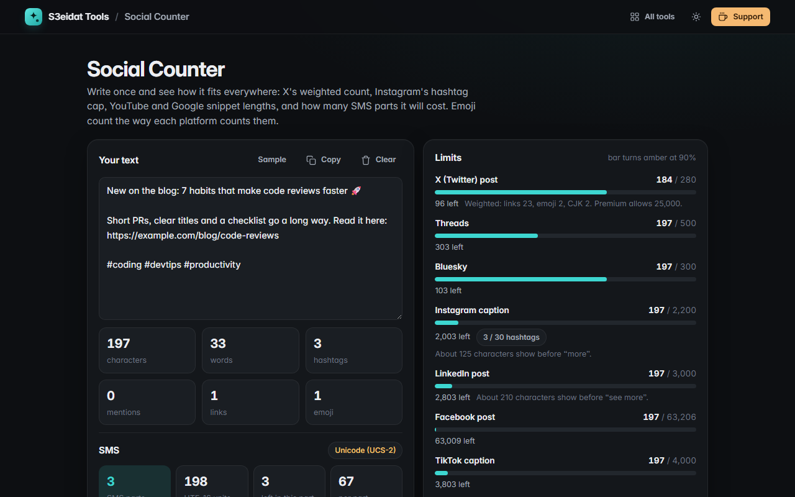

# Social Counter

> Character limits for X, Instagram, LinkedIn, TikTok, YouTube, Google and SMS, live as you type. Free, private, and it runs entirely in your browser.

### ▶ [Open Social Counter](https://s3eidat.github.io/social-counter/)



## Features

- **X (Twitter) weighted count** using the twitter-text rules: Latin, Arabic and most European scripts count 1, CJK counts 2, every emoji sequence counts 2, every link counts 23
- Meters for **Threads** (500), **Bluesky** (300), **Instagram** caption (2,200 and the 30-hashtag cap), **LinkedIn** (3,000), **Facebook** (63,206), **TikTok** (4,000), **YouTube** title (100) and description (5,000), **Pinterest** (500)
- **Google** title (~60 characters, plus an estimated pixel width) and **meta description** (~160)
- **SMS**: detects GSM-7 vs Unicode (UCS-2), counts parts exactly (160/153 vs 70/67), counts `^ { } [ ] ~ \ | €` as two, never splits an escape or emoji across parts
- Lists the characters that force Unicode and can **replace smart quotes, dashes and ellipses** with GSM look-alikes to cut the SMS cost
- Emoji are counted as one character (grapheme) each, the way people see them
- Characters, words, hashtags, mentions, links and emoji; text is autosaved on this device

Limits change from time to time; the numbers here are the published limits as of 2026.

## Privacy

Your text never leaves your device. There is no server, no account, no analytics.
The page ships with a strict Content-Security-Policy (`connect-src 'self'`), so the browser
itself blocks any attempt to send data anywhere. The autosave uses your browser's local storage;
**Clear** removes it.

## Run it yourself

It's plain HTML, CSS and JavaScript with no build step:

```bash
git clone https://github.com/s3eidat/social-counter
cd social-counter
python -m http.server 8000
```

Then open http://localhost:8000.

## Support

If this saved you time, **[buy me a coffee ☕](https://s3eidat.github.io/coffee/)**. It keeps every tool free.

---

Part of **[S3eidat Tools](https://s3eidat.github.io/)**: 100+ free, private tools that run in your browser. MIT licensed.
